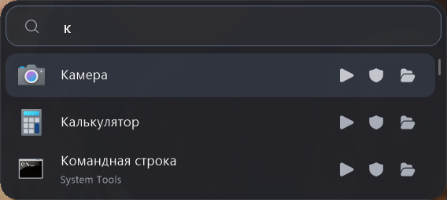
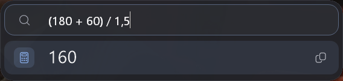
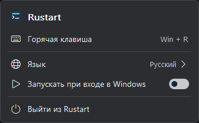

# Rustart

Rustart открывает приложения из меню «Пуск» и вычисляет выражения в одном поле. Нажмите **Win+R**, введите название программы или пример вроде `(180 + 60) / 1,5`. Язык интерфейса можно выбрать в трее. Названия установленных приложений берутся из Windows.



## Запуск

Скачайте `rustart.exe` из [релизов GitHub](https://github.com/CKATEPTb/rustart/releases), откройте его и подтвердите установку в запросе Windows. При первом запуске Rustart распакует приложение в `%ProgramFiles%\CKATEPTb\Rustart\rustart.exe`. Окно поиска и значок в трее принадлежат установленной копии. При обычном запуске она работает с правами текущего пользователя. Чтобы сразу перейти в трей, запустите `.\rustart.exe background`.

Левый клик по значку открывает поиск, правый клик открывает настройки. Команда **Выйти из Rustart** завершает работу и освобождает горячую клавишу. Если содержимое EXE совпадает с установленной копией, Rustart сразу передаёт ей команду. Для обновления откройте скачанный EXE новой версии. После подтверждения Windows он заменит установленный файл и передаст команду обновлённой копии. После установки скачанный файл можно удалить.

## Окно поиска


| Действие | Управление |
| --- | --- |
| Открыть лаунчер | `Win+R` по умолчанию |
| Переместить выделение | `↑`, `↓`, колесо мыши |
| Открыть приложение | `Enter`, двойной щелчок или кнопка запуска справа |
| Запросить права администратора для выбранной программы | `Ctrl+Shift+Enter` |
| Показать расположение программы в Проводнике | Кнопка папки в её строке |
| Скопировать результат вычисления | `Enter` или кнопка копирования |
| Закрыть окно и вернуть фокус | `Esc` |

Поле поиска открывается чуть выше середины активного монитора. Список под полем раскрывается, когда есть совпадения или готовый ответ калькулятора. Одновременно видны до трёх строк. Слева показаны системный значок и название приложения. Справа находятся кнопки запуска, запроса прав администратора и открытия папки. Стрелки перемещают выделение и прокручивают выдачу.

Если сам Rustart запущен от имени администратора, обычный запуск передаётся пользователю, которому принадлежит рабочий стол Windows. Для ярлыка на EXE сохраняются аргументы, рабочая папка и режим окна. Если программа требует повышения, Rustart предложит выбрать щит или нажать `Ctrl+Shift+Enter`. Если права проверить невозможно, запуск останавливается. Это ограничение затрагивает, в частности, ссылки ClickOnce `.appref-ms` и пакеты с разрешением на повышение прав.

Интернет-ярлык `.url` может открыть веб-страницу или игру Steam, если Windows указывает прямой EXE для соответствующего протокола. Для игр поддерживаются ссылки `steam://rungameid/<ID>` и `steam://run/<ID>`.

Кнопка папки открывает Проводник и выделяет файл, на который указывает ярлык. Если цель недоступна, Проводник выделяет сам ярлык в меню «Пуск». Для пакетного приложения Rustart открывает папку установленной версии. Если Windows ограничивает доступ, Rustart показывает приложение в системной папке «Приложения».

Поиск учитывает точное имя, начало названия, отдельные слова и сокращения вроде `vsc` для Visual Studio Code. При первом запросе приложения Rustart собирает ярлыки из личного и общего меню «Пуск» и приложения Windows из AppsFolder. Пустое поле и калькулятор работают без загрузки каталога. Дальше Rustart ждёт уведомлений Windows об изменениях. При открытом окне выдача обновляется автоматически. Изменения, пришедшие в трее, обрабатываются при следующем поиске. Несколько изменений подряд обрабатываются вместе.

Ярлыки одного EXE занимают одну строку и находятся по любому из своих названий. При запуске используются аргументы ярлыка, лучше всего совпавшего с запросом. У одноимённых программ с разными EXE под названием показан путь. Для доступных локальных файлов сравниваются идентификаторы файловой системы. Для сетевых и недоступных файлов используется нормализованный путь. Для пакетного приложения Rustart учитывает идентификатор Windows и может сопоставить его с прямым ярлыком на EXE из манифеста пакета.

Значки приложений загружаются из Windows в фоне для видимых строк с учётом масштаба экрана. Пока окно открыто, кэш хранит до 48 значков. Через две секунды после закрытия Rustart освобождает кэш, шрифты и ресурсы отрисовки. Список приложений сохраняется для следующего поиска. Пиктограммы поля и кнопок встроены в EXE. [Microsoft Fluent UI System Icons](https://github.com/microsoft/fluentui-system-icons) · [Лицензия MIT](assets/licenses/fluentui-system-icons.txt).

## Калькулятор



Поддерживаются `+`, `-`, `*`, `/`, степень `^`, остаток от деления `%` и скобки. Для десятичной части подходят точка и запятая. Калькулятор также понимает `×`, `÷`, знак минуса `−` и экспоненциальную запись вроде `2,5e3`. Вычисления используют числа двойной точности. Названия с цифрами, например `7-Zip`, обрабатывает поиск.

## Настройки трея



- **Запускать при входе в Windows** добавляет запуск в трее при входе текущего пользователя. Сразу под этой строкой появляется переключатель со щитом.
- **От имени администратора** регистрирует в Планировщике Windows задачу для вашей учётной записи. Если Rustart запущен с обычными правами, Windows попросит подтвердить действие при включении переключателя. При последующих входах Планировщик запускает установленный Rustart в трее с повышенными правами без повторного запроса UAC. Отключение щита возвращает обычный автозапуск. Если Windows запрашивает подтверждение изменения и вы отменяете его, сохраняется прежний режим.
- **Горячая клавиша** записывается прямо в меню. Нажмите эту строку, зажмите нужные клавиши вместе и отпустите. Подходят одиночные клавиши, сочетания с несколькими буквами и сочетания из одних модификаторов. Esc или щелчок вне меню отменяют запись. Если Windows отклоняет регистрацию, строка позволяет повторить попытку, а прежняя настройка сохраняется.
- **Язык** предлагает те же 12 языков, что и Rustile, и режим **Как в Windows**. Выбор применяется сразу и запоминается.

Язык и горячая клавиша сохраняются в `%LOCALAPPDATA%\Rustart\settings.json`. Автозапуск хранится в настройках Windows для текущего пользователя.

## CLI

Из папки `%ProgramFiles%\CKATEPTb\Rustart` команды можно вызывать в PowerShell.

```powershell
.\rustart.exe show
.\rustart.exe hide
.\rustart.exe status
.\rustart.exe refresh
.\rustart.exe search "powershell"
.\rustart.exe calc "2^3 + 0,5"
.\rustart.exe quit
```

`status` печатает `running <PID>` и возвращает код 0, когда экземпляр готов. Если он остановлен, команда печатает `stopped` и возвращает 1. `search` и `calc` выводят результат прямо в терминал и работают при закрытом лаунчере.

## Ресурсы

В версии **0.4.3** размер LZX-пакета составляет 772 608 байт, размер установленного EXE составляет 1 164 800 байт. При проверке на Windows 11 x64 частный рабочий набор составлял 1,20 МиБ до первого открытия, 2,50 МиБ при поиске со значками и 2,49 МиБ через 13,5 секунды после возврата в трей. За пять секунд простоя счётчик процессорного времени показал прирост 0 мс.

В Windows 11 x64 у версии **0.4.0** частный рабочий набор составлял 1,17 МиБ в трее до открытия, 2,48 МиБ в поиске со значками и 2,43–2,46 МиБ после возврата в трей. При первом поиске суммарный наблюдаемый пик с учётом временного процесса составил 4,91 МиБ. Полный рабочий набор, включая общие страницы Windows, составлял 10,37 МиБ сразу после запуска и 22,75–22,79 МиБ после возврата в трей. За пять секунд простоя счётчик процесса показал 0 мс процессорного времени. Размер EXE составляет 1 084 928 байт.

<details>
<summary>Замеры версий 0.3.5 и 0.3.6</summary>

Обе релизные сборки проверены на одном компьютере с Windows 11 x64. В каждой ячейке указаны результаты для **0.3.5 → 0.3.6**, в МиБ. Частный рабочий набор показывает физическую память, принадлежащую только процессу. Полный рабочий набор также учитывает общие страницы, в том числе системные DLL. Размер EXE версии 0.3.6 составляет 921 600 байт.

| Состояние | Частный рабочий набор | Выделено процессу (Private Bytes) | Полный рабочий набор |
| --- | ---: | ---: | ---: |
| В трее до первого открытия | 1,42 → 1,17 | 2,02 → 1,66 | 12,38 → 10,30 |
| Открыт поиск, видны результаты со значками | 4,43 → 2,56 | 7,48 → 3,48 | 37,64 → 22,35 |
| В трее через 2,5 с после работы | 6,16 → 2,36 | 9,53 → 3,18 | 51,77 → 22,31 |
| В трее через 13,5 с после работы | 6,16 → 2,36 | 9,53 → 3,18 | 51,77 → 22,31 |

Проверка включала запуск обычных и пакетных приложений, открытие их папок, изменение настроек и 17 циклов открытия и закрытия интерфейса. Для замеров в таблице оставался один процесс Rustart. По счётчику Windows за 5,01 секунды простоя он использовал 0 мс процессорного времени. При открытии версии 0.3.6 после 13,5 секунды в трее поле получило фокус за 7 мс, а первая строка появилась через 42 мс после ввода. В трёх повторах с паузой 2,5 секунды медианы составили 15 и 25 мс соответственно.

В версии 0.3.6 каталог, значки и команды Проводника обслуживают временные процессы того же EXE. При первом поиске наблюдаемый суммарный пик частного рабочего набора вырос с 4,42 до 5,07 МиБ, а пик Private Bytes — с 7,48 до 7,94 МиБ. Измеритель опрашивал процессы с заданной паузой 15 мс. Первая строка по запросу появилась через 212 мс в 0.3.5 и 336 мс в 0.3.6. Абсолютные значения зависят от содержимого меню «Пуск», состояния кэшей и версии Windows.

</details>

## Сборка и проверка

Для сборки нужны Rust с целевой платформой `x86_64-pc-windows-msvc`, MSVC Build Tools и Windows SDK. Проект использует нативные окна Win32, системный шрифт и цикл ожидания сообщений Windows.

```powershell
cargo build --release --locked
cargo test --locked --all-targets
cargo clippy --locked --all-targets -- -D warnings
cargo fmt --check
```

Для сборки скачиваемого EXE выполните `.\scripts\package-release.ps1`. Сценарий собирает Rustart для Windows x64, сжимает приложение в CAB алгоритмом LZX с окном 2 МиБ, проверяет SHA-256 распакованных данных и создаёт `dist\rustart.exe`. В `target\release\rustart.exe` после обычного `cargo build --release` находится приложение для установки.

Чтобы сменить версию релиза, отредактируйте [VERSION](VERSION) и выполните `.\scripts\sync-version.ps1` в PowerShell 7. Сценарий обновит версии пакетов Cargo и файлы блокировки. При сборке эта же версия записывается в свойства обоих EXE.

GitHub Actions проверяет push и pull request в `development` и `production` на Windows x64. После успешной сборки при push в `production` workflow публикует LZX-сжатый `rustart.exe` в GitHub Releases и сверяет его SHA-256. Тег содержит версию и номер запуска, например `v0.4.3+build.8`.

Сценарий `.\tests\release-package.ps1` проверяет упаковку, передачу аргументов и потоков CLI. Для проверки первого запуска и обновления закройте Rustart и запустите `.\tests\installation-smoke.ps1`. Сценарий использует временную папку установки. Сценарий `.\tests\desktop-smoke.ps1` проверяет сам лаунчер в интерактивном сеансе Windows с отдельной папкой настроек и временными ярлыками.

- `-CheckReveal` проверяет открытие папки и выделение файла в Проводнике.
- `-CheckCalculatorApp` открывает и закрывает установленный Калькулятор Windows. Вместе с `-CheckReveal` проверяет и переход к расположению этого приложения.
- `-CheckRunDialog` проверяет возврат стандартного `Win+R` в русской, английской или немецкой оболочке.
- `-CheckClipboard` проверяет `Enter` и кнопку копирования, записывая результаты в буфер обмена текущего сеанса.

Сценарий `.\tests\startup-task.ps1` проверяет параметры задачи входа через Планировщик Windows. Ключ `-CheckRegistration` в консоли администратора дополнительно создаёт, проверяет и удаляет отдельную отключённую тестовую задачу. Ключ `-Installed` проверяет задачу текущего пользователя, если в трее включён повышенный автозапуск.

Команда `.\tests\launch-privilege.ps1 -RequireHigh` из повышенной консоли проверяет права дочерних GUI- и консольных программ, аргументы и рабочую папку ярлыков, а также отказ обычного запуска для программ, требующих повышения.
